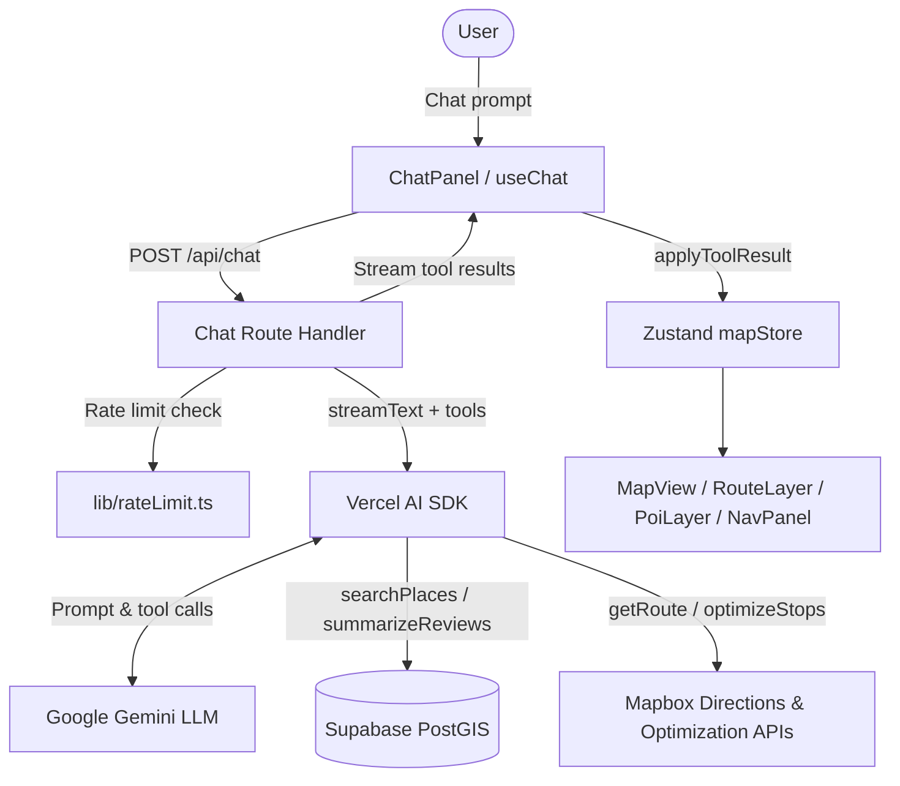

# CompassAI

An AI assistant that drives the map.
Live: https://ai-powered-map-application.vercel.app

## What It Does
- **Interactive Map**: Vector base map with light/dark styles, smooth pan/tilt/bearing controls, zoom buttons, and visual scale bar.
- **GPS Location**: Live geolocation tracking with accuracy circle, heading tracking, and recentering.
- **Search & Geocoding**: Forward geocoding, debounced autocomplete suggestions, reverse geocoding, and recent search history.
- **Routing & Turn-by-Turn**: Multi-modal directions (drive, walk, cycle) with route preview, step maneuvers, ETA, and progress bar.
- **POIs & Legend**: 8 curated POI categories rendered with custom SVGs, clustering, interactive sheets, and category toggles.
- **Conversational Search**: Natural language place queries executed via schema-validated database tools instead of LLM memory.
- **Multi-Stop Route Optimization & Dynamic Rerouting**: Sequence optimization for up to 5 errands and automatic off-route/traffic rerouting.
- **Review Insights**: Instant AI synthesis of visitor feedback highlighting pros, cons, vibe, and best-for tags.
- **Personalized Recommendations**: Transparent preference onboarding boosting relevant nearby spots deterministically.

## Architecture


## How the AI Is Kept Honest
- **Tools Only**: The LLM is strictly instructed never to answer place or routing queries from memory.
- **Grounded in Tool Results**: Model responses are restricted strictly to data returned by verified tool outputs.
- **IDs Over Coordinates**: `getRoute` and `optimizeStops` take validated POI UUIDs rather than hallucinated coordinates.
- **Deterministic Stop Ordering**: Errand order is computed directly by the Mapbox Optimization API, never guessed by the model.
- **Code-Driven Personalization & Notices**: Interest ranking (`dist * 0.7`) and reroute banner messages are computed in code, not by the model.
- **Rate Limits**: In-memory sliding-window limits (12 req/min, 150 req/hr) and daily request caps enforce quota integrity.

## Tech Stack
- **Framework & Language**: Next.js 16.4.6 (App Router), React 19.3.0, TypeScript ^5
- **AI Integration**: AI SDK ^7.0.172, @ai-sdk/react ^4.0.177, @ai-sdk/google ^4.0.120
- **Mapping & Geospatial**: Mapbox GL ^3.34.2, react-map-gl ^8.1.3, Turf.js ^7.4.0 (@turf/along, @turf/bbox, @turf/distance, @turf/helpers, @turf/length, @turf/nearest-point-on-line)
- **Database**: Supabase PostgreSQL + PostGIS via @supabase/supabase-js ^2.119.0
- **State & Validation**: Zustand ^5.1.0, Zod ^4.6.7
- **UI & Styling**: Tailwind CSS 4.3.3, shadcn components, Lucide React ^1.72.0

## Setup
1. **Prerequisites**: Node.js 20+, npm, and active Mapbox, Supabase, and Google Gemini accounts.
2. **Install**:
   ```bash
   npm install
   ```
3. **Configure Environment Variables**:
   Copy `.env.example` to `.env.local` and define variable names:
   `NEXT_PUBLIC_MAPBOX_TOKEN`, `MAPBOX_SECRET_TOKEN`, `SUPABASE_URL`, `SUPABASE_ANON_KEY`, `SUPABASE_SERVICE_ROLE_KEY`, `NEXT_PUBLIC_SUPABASE_URL`, `NEXT_PUBLIC_SUPABASE_ANON_KEY`, `GOOGLE_GENERATIVE_AI_API_KEY`, `LLM_MODEL`, `LLM_FALLBACK_MODEL`, `HEALTH_TOKEN`, `OVERPASS_CONTACT`, `CHAT_DAILY_CAP`.
4. **Database Migrations**:
   Execute the migration SQL files in order inside Supabase SQL Editor:
   - `supabase/migrations/0001_init.sql`
   - `supabase/migrations/0002_nearby_pois.sql`
5. **Seed Data**:
   ```bash
   npm run seed:pois
   npm run gen:reviews
   npm run gen:summaries
   ```
6. **Run**:
   ```bash
   npm run dev
   ```

## Data and Honesty Notes
- **Place Data**: Places come from OpenStreetMap contributors (ODbL).
- **Manual POIs**: A few pharmacies were added manually via `data/manual-pois.json` to backfill sparse OSM tag coverage.
- **Sample Reviews**: Reviews, star ratings, and summaries are AI-generated sample data.
- **Semantic Search**: Semantic search is not built; place discovery uses PostGIS spatial and keyword filters.
- **Debug Simulator**: The demo simulator and Divert controls are hidden unless the URL has `?debug=1`.

## Known Limitations
- **Serverless Rate Limiting**: The in-memory rate limit is per-instance on serverless platforms.
- **Free LLM Quota**: Free LLM tier quotas may limit rapid consecutive requests.
- **Place Coverage**: Place coverage is limited by OpenStreetMap Greater Noida data.
- **Multi-Stop Navigation**: Multi-stop navigation arrives only at the final destination.
- **Traffic Check Frequency**: The 60-second traffic check is rarely triggered on short trips (requires >=3 min savings).

## Scripts Reference
- `npm run dev`: Starts the development server with webpack.
- `npm run build`: Builds the application for production with webpack.
- `npm run start`: Starts the Next.js production server.
- `npm run lint`: Runs ESLint code quality checks.
- `npm run seed:pois`: Fetches and seeds POIs from OpenStreetMap and manual entries into Supabase PostGIS.
- `npm run gen:reviews`: Generates synthetic sample reviews using Gemini and stores them in Supabase.
- `npm run gen:summaries`: Generates AI sentiment and review summaries for POIs.
- `npm run test:chat`: Tests conversational chat and tool execution via CLI.
- `npm run test:reroute`: Tests off-route detection and dynamic rerouting logic.
- `npm run test:ratelimit`: Tests sliding-window rate limiting and request cap mechanisms.
